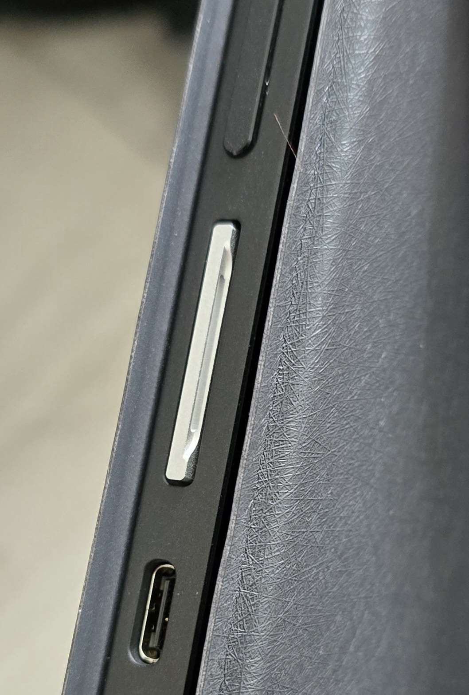

Awesome Minisforum V3
=====================

Useful (unofficial) information for [Minisforum V3 AMD Tablet](https://www.minisforum.com/page/v3/index.html?lang=en) users.

## Reviews

- [Minisforum V3 3-in-1 review: the first ever Windows tablet with AMD's Hawk Point APU aka the AMD Ryzen 7 8840U](https://www.notebookcheck.net/Minisforum-V3-3-in-1-review-the-first-ever-Windows-tablet-with-AMD-s-Hawk-Point-APU-aka-the-AMD-Ryzen-7-8840U.829081.0.html) by Notebookcheck
- [A Brief Review of the Minisforum V3 AMD Tablet](https://mudkip.me/2024/04/14/A-Brief-Review-of-the-Minisforum-V3-AMD-Tablet/) by Mudkip
- [Minisforum V3 Tablet - hardware compatibility report](https://www.reddit.com/r/linuxhardware/s/rQ7BrCkx4w) by Tsuki4735

## Videos

- [MinisForum V3 vs. Surface Pro 10 - Which Tablet is Better? Comprehensive.](https://www.youtube.com/watch?v=reh_iWrlJV8) by cbutters Tech
- [Minisforum V3 Tablet (AMD R7 8840U) Review: Tweaking Guide, Benchmarks, Hawk Point Testing](https://www.youtube.com/watch?v=ivm78Qyls3A) by Moore's Law Is Dead
- [Android + SteamOS on a Tablet! Minisforum V3 Quick Impressions (feat. Bazzite OS)](https://www.youtube.com/watch?v=MrlnZXNTvtM) by Aru
- [Tablet PCs are Kind of Amazing [MinisForum V3 Review]](https://www.youtube.com/watch?v=8P0G-JLeZD4) by Retro Game Corps
- [Minisforum V3 FULL Walkthrough. Ryzen 7 8840U Windows 11 Pro Tablet](https://www.youtube.com/watch?v=c_zbxrHhtQA) by TechTablets
- [It's a THICK tablet and I'm kinda into that - Minisforum V3](https://www.youtube.com/watch?v=kI_Y231zwoU) by ShortCircuit (Linus Tech Tips)
- [Minisforum V3 AMD Tablet Review! The Best 3 in 1 We've Ever Gotten Our Hands On](https://www.youtube.com/watch?v=Sy4PjHci6qs) by ETA PRIME
- [Minisforum V3 Tablet FULL Test and Review: This is Stupid Fast - Ryzen 8840U, 32GB RAM, 2560x1600](https://youtu.be/hIwAlQLy8Go?si=vSMEaYY7aPcamGkk) by Tek Syndicate

## Resources

- [Drivers and Firmware Update](https://www.minisforum.com/new/support?lang=en#/support/page/download/120)
- [Minisforum Discord Server](https://discord.com/invite/Pxrg8WpFCa)
- [RyzenAdj](https://github.com/FlyGoat/RyzenAdj): Adjust power management settings.

## Guide for Windows Users

### V3 Adj

A kludge of scripts with [RefreshRateSwitcher](https://github.com/sryze/RefreshRateSwitcher) and [RyzenAdj](https://github.com/FlyGoat/RyzenAdj) to control power limits along with auto setting brightness and refresh at startup and when the unit is swapped between AC power and Battery.

Extract [V3Adj.zip](https://github.com/mudkipme/awesome-minisforum-v3/blob/main/scripts/V3Adj.zip) to `C:\` and run `V3 Adj task install.bat` **as Administrator** to install. 

> [!NOTE]
> - Defaults to 37W and 9.5W for AC and Battery.
> - Edit values in `V3_PowerSwap.bat` to set your own limits.

> [!WARNING]
> You need to set the BIOS profile to 54W to be able to increase the current limits!

### CRU profile to expand VRR range down to 36Hz

[CRU V3 Profile.zip](https://github.com/mudkipme/awesome-minisforum-v3/blob/main/scripts/Cru%20V3%20Profile.zip) is [Custom Resolution Utility](https://www.monitortests.com/forum/Thread-Custom-Resolution-Utility-CRU) By ToastyX and a profile made for the V3 Tablet that extends the VRR range.

1. Extract [CRU V3 Profile.zip](https://github.com/mudkipme/awesome-minisforum-v3/blob/main/scripts/Cru%20V3%20Profile.zip)
2. Run `CRU.exe`
3. Import the `v3 36 to 165.bin` file
4. Restart the display driver with `restart64.exe`, or reboot the machine

### Enable integer scaling

Run [Embeded_Integer_Scaling_On.reg](scripts/Embeded_Integer_Scaling_On.reg) and reboot Windows. Then enable integer scaling in *Display* in *AMD Software: Adrenalin Edition*. _Credits to Wobble._

## Guide for Linux Users

### Drivers: fan speeds, temperatures, BIOS fan mode, accelerometer

[`linux/driver`](linux/driver) contains two DKMS kernel modules (no BIOS/EC flashing):

- `minisforum_v3_wmi`:
  - CPU + system fan RPM and eight EC temperatures (`sensors`);
  - the BIOS thermal mode (Quiet / Balance / Performance) as `/sys/firmware/acpi/platform_profile`;
  - the DP-in WMI event.
  - It replaces the wrong `huawei_wmi` binding.
- `minisforum_v3_accel`: makes the stock `st_lsm6dsx` driver bind the accelerometer/gyro (ACPI `SMOCF05`), so auto-rotate works.

```bash
cd linux && sudo ./install.sh --driver && sudo ./driver/selftest.sh
```

> [!NOTE]
> Verified on BIOS 1.05/1.06 with EC 8.8. On other firmware the driver keeps its EC command channel off.

The firmware analysis behind it (EC RAM map, vendor EC commands, WMI, ACPI) is in [`linux/docs/firmware-analysis.md`](linux/docs/firmware-analysis.md).

### Full 28 W on the charger (and more), low watts on battery

A stock Linux install stays at **15 W sustained even on AC**. The sustained limit (STAPM) comes from the **BIOS thermal mode**:
- Quiet/low-power = 15 W;
- Performance = 28 W.

ryzenadj and ALIB can't change STAPM on this BIOS, so ryzenadj-only TDP scripts have no sustained effect while the tablet is in Quiet mode.

To get the power back:
- Switch to performance mode, the same EC command Minisforum Space uses on Windows. This gives 28 W sustained.
- On top of that, ryzenadj's fast/slow limits reach 36–40 W until the chip's own 90 °C limit.
- Lowering limits on battery works in any mode (8 W measured).

Measurements, what doesn't work, and a warning about ALIB calls: [`linux/docs/power-limits.md`](linux/docs/power-limits.md).

### Fan curve control

The EC's live fan table sits in EC RAM and can be rewritten. Six duty levels, volatile, and the factory curve comes back on every mode switch. Layout, factory tables and safety checks: [`linux/docs/fan-curve.md`](linux/docs/fan-curve.md).

### V3 Power: power manager + COSMIC panel applet

[`linux/v3-power`](linux/v3-power) and [`linux/applet`](linux/applet) contain:
- **Profiles:** battery/charger profiles (BIOS mode, power limits, fan curve, EPP, ASPM, panel power saving, Wi-Fi power save, 60/165 Hz).
- **Background services:** auto-stop selected services (Docker, Podman…) on battery.
- **Panel applet:** tabs for power, performance (limits + fan curve + live sensors), firewall (ufw rule editor) and tools (keep awake, auto-brightness).

Built and tested on Pop!_OS 24.04 (COSMIC). See [`linux/README.md`](linux/README.md) and [`linux/docs/pop-os-tuning.md`](linux/docs/pop-os-tuning.md).

### Speakers too quiet

After boot the ALC245 hardware `Master` control sits at **−23 dB**. PipeWire never raises it, and `alsactl store` doesn't survive a reboot.

Set it at login, and after resume:
```bash
amixer -c Generic_1 sset Master 100%
```
[`linux/user/systemd/v3-audio-master.service`](linux/user/systemd/v3-audio-master.service) runs it at every login. This also complements the "volume = ignore" workaround below, which leaves `Master` wherever it was.

### Battery charge threshold (BIOS)

BIOS 1.05+ has **Advanced → ACPI setting → Battery charging start** (95 % / 80 % / 50 %). Charging starts only below that level, which stops the constant top-up at 99–100 % while plugged in. It's greyed out if you entered Setup as *User* with a BIOS password set.

### Automatic rotation and accelerometers

See https://github.com/mudkipme/awesome-minisforum-v3/issues/2#issuecomment-2279282784, or the `minisforum_v3_accel` driver above.

### Fix volume buttons not working when the keyboard is detached

> [!NOTE]
> [libinput](https://gitlab.freedesktop.org/libinput/libinput/-/releases/1.26.2) 1.26.2 is released with quirks for Minisforum V3.
> If you are using Arch-based distributions or Fedora 40, you don't need to do this manually.

Quick install:

```bash
curl -L https://raw.githubusercontent.com/mudkipme/awesome-minisforum-v3/main/scripts/linux_fix_sound.sh | sudo sh
```

Manual Install:

Create `/etc/libinput/local-overrides.quirks` with the following content:
```ini
[Minisforum V3 volume keys]
MatchName=AT Translated Set 2 keyboard
MatchDMIModalias=dmi:*svnMicroComputer(HK)TechLimited:pnV3:*
ModelTabletModeNoSuspend=1
```

### Workaround for global volume control with the speaker

> [!WARNING]
> `alsa-firmware` is required for this to work!

1. Download [alsa-soft-mixer.conf](scripts/alsa-soft-mixer.conf) to `/etc/wireplumber/wireplumber.conf.d/alsa-soft-mixer.conf`
    - Use `~/.config/wireplumber/wireplumber.conf.d/alsa-soft-mixer.conf` for a per-user basis. 
2. Reboot the system

> [!NOTE]
> Run `wpctl status` and `pactl list short cards` to see which card is applicable if this does not work. Whichever matches `Family 17h/19h HD Audio Controller` is the correct card
> Example output
> ```
> ❯ wpctl status
> 
> Audio
>   └─  Devices:
>       48. Rembrandt Radeon High Definition Audio Controller [alsa]
>       49. Family 17h/19h HD Audio Controller  [alsa]
>  
> ❯ pactl list short cards
> 
> 48      alsa_card.pci-0000_c4_00.1      alsa
> 49      alsa_card.pci-0000_c4_00.6      alsa
> ```

_Credits to Aru._

### Alternative Workaround for Global Volume Control
> [!NOTE]
> This workaround does not include adding in the a alsa-soft-mixer.conf file that the previous workaround recommends. Adding that file may have different results.

1. Add the following to `/usr/share/alsa-card-profile/mixer/paths/analog-output.conf.common` before `[Element PCM]`
>```
> [Element Master]
> switch = mute
> volume = ignore
>```
2. Modify `/usr/share/alsa-card-profile/mixer/paths/analog-output-headphones.conf` file. Simply make it so `[Element Master]` looks like the following, which is basically changing volume from "merge" to "ignore"
>```
>  [Element Master]
> switch = mute
> volume = ignore
> override-map.1 = all
> override-map.2 = all-left,all-right
>```
3. Restart the wireplumber service using `systemctl --user restart wireplumber.service`
4. Test headphones and speakers, they should be working with volume keys now

_Credits to ChaosSpectre & makito89_


### Disable audio session suspension

If you are seeing the headphone port keep dropping every few seconds when the port is used, you can disable audio session suspension.

Download [alsa-disable-suspension.conf](scripts/alsa-disable-suspension.conf) and move it to `~/.config/wireplumber/wireplumber.conf.d/alsa-disable-suspension.conf`.

### Manual rotation script

Download [rotateButton.sh](scripts/rotateButton.sh).  _Credits to Briar._

### Faical Recognition

The IR Camera works with [howdy](https://github.com/boltgolt/howdy). Fedora-based distribution users can install [howdy-beta](https://copr.fedorainfracloud.org/coprs/principis/howdy-beta/) with Copr. _Credits to Tsuki4735._

The `device_path` in `/etc/howdy/config.ini` needs to be set to `/dev/video3`.

> [!NOTE]
> `/dev/video2` may be required instead for specific models.

### Remap Copilot Button

By default, the Copilot button triggers `Super L + Shift L + XF86TouchpadOff`.
It can be remapped using [Input Remapper](https://github.com/sezanzeb/input-remapper) (tested on Nobara). For example, you can map it to `KEY_COMPOSE`, which bring up the context menu.

## Hardware Guide

### Micro SD Card Adapter

If you want to expand the storage of the tablet with the SD Card slot, the BaseQi iSDA 750A adapter is a good fit. _Credits to killshot007\_._



## Known Issues

- ~~Enabling AMD Fluid Motion Frames in *AMD Software: Adrenalin Edition* may cause Windows to reboot.~~
    - It seems this issue is fixed with latest AMD Software: Adrenalin Edition driver.
